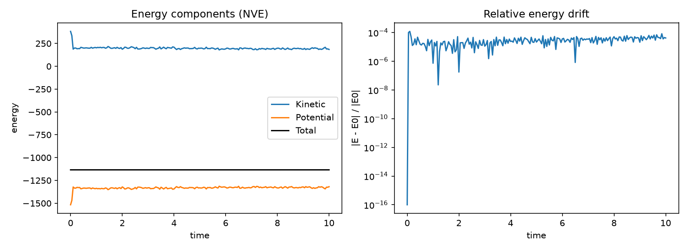
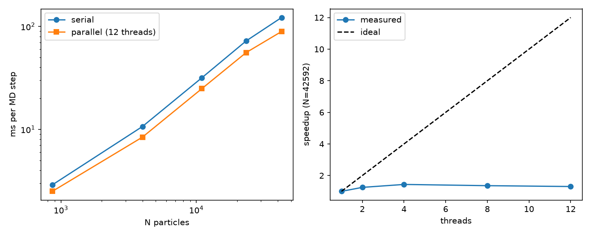
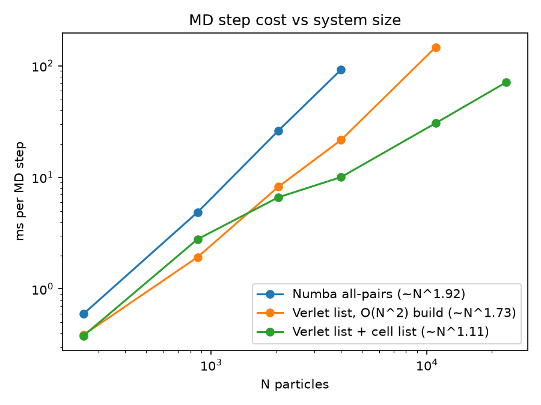

# mdlite

A small Lennard-Jones molecular dynamics code in Python, built step by step from a plain NumPy baseline up to a parallel Numba implementation. Each optimization is benchmarked and tested against the previous one.

## Features

- FCC lattice setup with Maxwell-Boltzmann velocities and periodic boundaries
- Velocity Verlet integrator (NVE)
- Lennard-Jones forces: NumPy all-pairs baseline, Numba serial kernel, parallel kernel with persistent per-chunk force buffers
- Verlet neighbor lists with a skin distance and lazy rebuild
- O(N) cell-list neighbor list construction, including a parallel half-shell build
- Fused parallel integrator kernels and parallel displacement check
- Test suite (pytest) covering each kernel against the reference implementation

## Install

```bash
git clone https://github.com/dmatharv25-cmd/mdlite.git
cd mdlite
pip install -e .
pip install pytest matplotlib
python -m pytest -q
```

## Quick start

```python
from mdlite.integrators import run_nve
from mdlite.system import create_fcc_system

system = create_fcc_system(4, density=0.8, temperature=1.0, seed=42)
log = run_nve(system, n_steps=2000, dt=0.005, record_every=10)

print(log["total"][0], log["total"][-1])  # total energy at start and end
```

The full script is `examples/nve_energy.py`. It runs a Lennard-Jones liquid and plots energy components and relative energy drift.



## Benchmarks

All timings were measured on a single development machine, so absolute numbers will differ on yours. The raw data is in `benchmarks/`.

### Force evaluation: NumPy vs Numba (ms per force call)

| N | NumPy | Numba serial | Speedup |
|------:|--------:|-------------:|--------:|
| 108 | 2.02 | 0.138 | 14.7x |
| 256 | 13.82 | 0.478 | 28.9x |
| 500 | 59.32 | 1.614 | 36.8x |
| 864 | 178.90 | 4.449 | 40.2x |
| 1372 | 377.28 | 10.81 | 34.9x |

### Neighbor lists: all-pairs vs cell list (ms per step)

| N | All-pairs | Cell-list neighbor list | Speedup |
|------:|----------:|------------------------:|--------:|
| 864 | 5.06 | 2.80 | 1.8x |
| 2048 | 25.64 | 6.42 | 4.0x |
| 4000 | 91.30 | 10.04 | 9.1x |

The cell-list version keeps scaling roughly linearly: going from N = 4000 to N = 23328 (5.8x more particles) takes 7.0x longer.

### Parallel vs serial (ms per step)

| N | Serial | Parallel | Speedup |
|------:|-------:|---------:|--------:|
| 864 | 2.91 | 1.07 | 2.7x |
| 4000 | 10.32 | 4.43 | 2.3x |
| 10976 | 31.68 | 9.15 | 3.5x |
| 23328 | 72.41 | 18.29 | 4.0x |
| 42592 | 122.47 | 29.96 | 4.1x |

Parallel efficiency improves with system size because the fixed per-step overhead matters less.




## Project layout